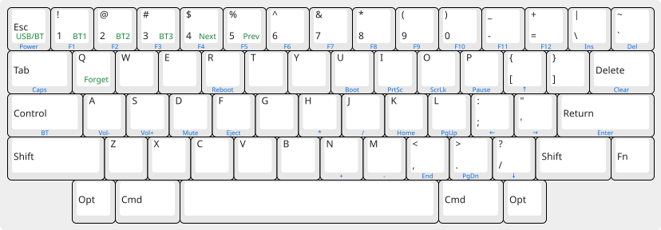

# HHKB Pro 2 RMK Firmware

[RMK](https://github.com/rmk-rs/rmk) firmware (Rust, embassy) for an HHKB Pro 2 with a nice!nano v2 wired to the Topre board.

Based on the work in [hhkb-zmk](https://github.com/kanru/hhkb-zmk), ported to RMK to support Vial.

For hardware build instructions, follow [Soldering a custom board](https://github.com/kanru/hhkb-zmk#soldering-a-custom-board) in the hhkb-zmk repo.

## Differences

| | TMK | hhkb-zmk | hhkb-rmk |
|---|---|---|---|
| Wireless | Bluetooth Classic (RN-42 module) | Bluetooth LE | Bluetooth LE |
| Keymap changes | Web editor, then reflash | ZMK Studio, live | Vial, live |
| Board power | On, per scan after 10 s idle | On for each scan | On, per scan after 30 s idle |
| Idle scanning | Every ~25 ms | Every ~40 ms | Every ~25 ms, then 250 ms after 10 min |
| Glitch filter | Drops interrupted reads | None | Two scans must agree |

## Flash a release

Download the `.uf2` from [Releases](https://github.com/nielthiart/hhkb-rmk/releases), press Fn+U, then run `cp -X <file>.uf2 /Volumes/NICENANO/`. On other systems, drag it onto the NICENANO drive.

## Go back to ZMK

This firmware overwrites the nice!nano's SoftDevice, so ZMK only boots again when built with the `nrf52840-nosd` snippet ([RMK FAQ](https://rmk.rs/docs/getting_started/faq#zmk-no-longer-works-after-flashing-rmk)). In hhkb-zmk's `build.yaml`, set the `nice_nano_v2` entry to `snippet: studio-rpc-usb-uart;nrf52840-nosd`. Or [re-flash the bootloader](https://nicekeyboards.com/docs/nice-nano/troubleshooting/#i-can-still-get-into-the-existing-bootloader-over-usb) to restore the SoftDevice, after which normal ZMK builds boot again.

## Build and flash

Only tested on macOS 27.

Warning: Anything that recompiles `rmk` (cargo clean, an upgrade, feature changes) wipes Vial edits and Bluetooth bonds on the next flash.

Changes to `keymap.rs` only reach the keyboard after such a wipe, because RMK keeps the stored keymap. Run `cargo clean -p rmk` before flashing them.

1. Install [Rust](https://rustup.rs), then the build tools:

   ```bash
   brew install arm-none-eabi-binutils
   cargo install flip-link cargo-binutils cargo-hex-to-uf2
   ```

2. Connect the HHKB Pro 2 by USB.

3. Press Fn+U to enter the bootloader.

4. To build and flash, run:

   ```bash
   ./flash.sh
   ```

To test builds in development, `cargo build --release` builds without flashing.

## Keys



Left (black): base layer. Front of the key (blue): hold Fn. Bottom right (green): hold Fn+Control.

- Fn+R reboots.
- Fn+U enters the bootloader.
- Hold Fn+Control for the Bluetooth layer:
    - Esc toggles USB and Bluetooth
    - 1 to 3 pick a profile (hold five seconds to forget it)
    - 4 and 5 go to the next and previous profile
    - Q forgets the current profile
- Vial: edit the keymap at [vial.rocks](https://vial.rocks/) (USB or BLE supported in Chrome). Hold Esc and Backspace to unlock the matrix tester.

## Credits

- [Kan-Ru Chen](https://github.com/kanru): [hhkb-zmk](https://github.com/kanru/hhkb-zmk), the scanner and wiring this is ported from.
- [HaoboGu](https://github.com/HaoboGu): [RMK](https://github.com/rmk-rs/rmk) and its nRF52840 example, the base of `main.rs`.
- [Hasu](https://github.com/tmk): [TMK](https://github.com/tmk/tmk_keyboard), which documented the HHKB Pro 2 controller interface.

Ported to Rust from hhkb-zmk's C scanner with Claude.
